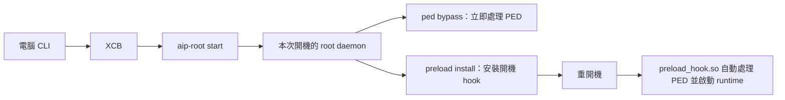
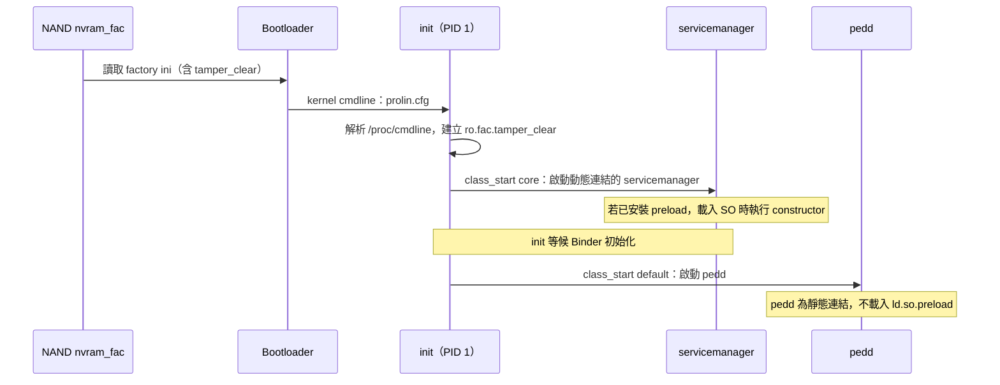
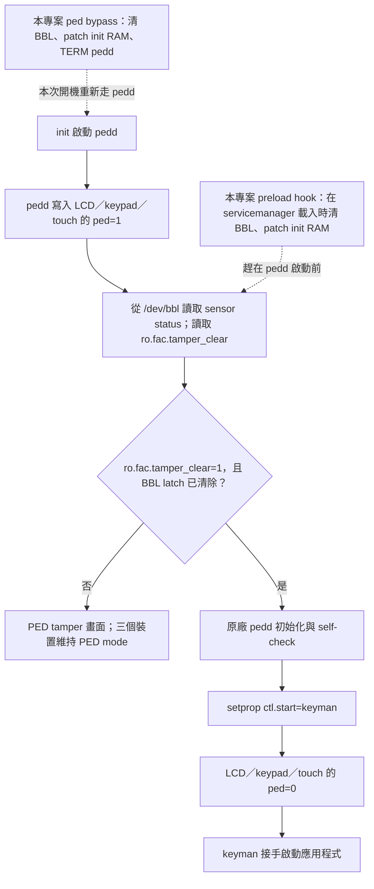
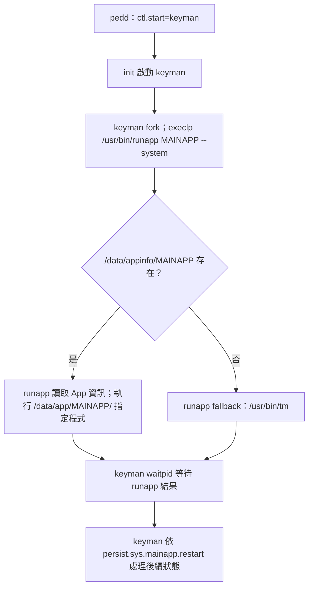
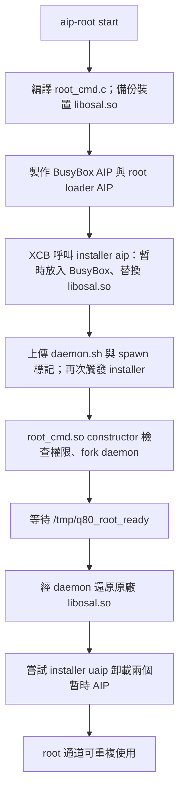
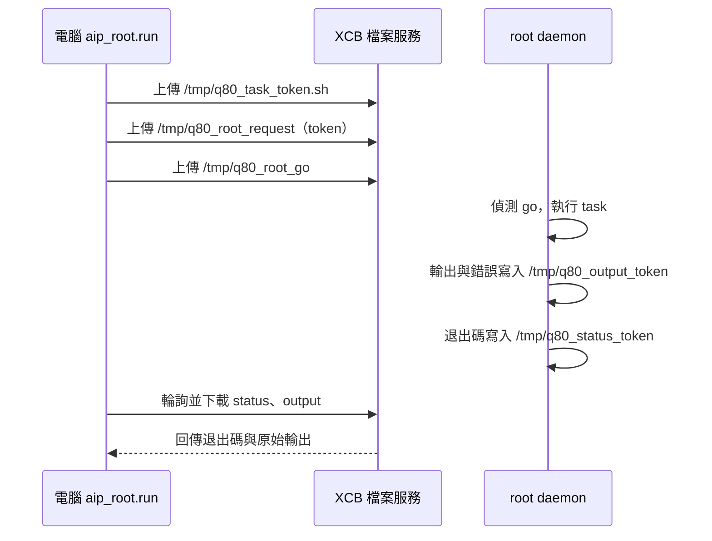
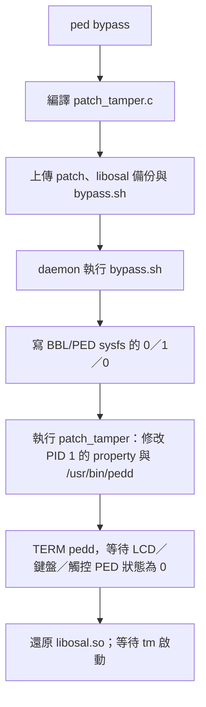
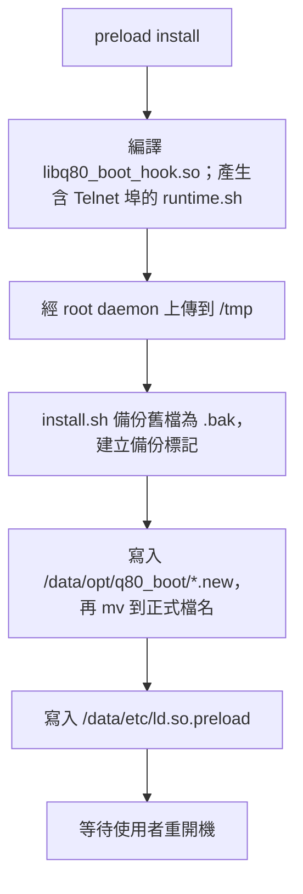
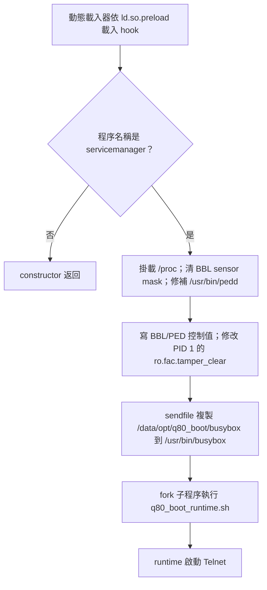

# AIP root、PED 與 preload 技術流程

本文記錄目前程式實際執行的順序與路徑；使用指令見 [README](../README.md)。三個流程共用 XCB，但用途不同：

| 模組 | 入口 | 生效時間 |
| --- | --- | --- |
| `aip-root` | XCB 安裝暫時 AIP，啟動 root daemon | 本次開機，直到 `stop` 或重開機 |
| `ped bypass` | 將腳本交給 root daemon | 本次開機 |
| `preload install` | 寫入 `ld.so.preload`，由開機程序載入 hook | 後續每次開機，直到 `restore` |

## 原廠開機與應用程式啟動

以下原廠行為依據 `q80-adb/doc/ped-clear.md`、`q80-adb/doc/q80-auto-boot.md`、`q80-adb/doc/q80-app-startup.md` 的逆向與實機紀錄。`class_start` 的先後順序來自該專案的開機觀察；目前沒有原廠 `init.rc` 原檔可逐行對照。後文的手動 PED bypass 與 preload 是本專案在原廠流程中的兩個介入點。

### 從 factory 設定到 pedd

這台裝置的 factory `tamper_clear=0` 位於 `nvram_fac` 第一份 factory 記錄的 `ini` 中，經 `prolin.cfg` 成為 init RAM 裡的 `ro.fac.tamper_clear=0`；它不是 `/data/property/ro.fac.tamper_clear`。逆向紀錄也曾用原廠 `systemservice` 對 NVRAM 寫入第二份 `tamper_clear=1` 記錄，但冷開機仍讀到舊的 factory 值，因此不能把第二份記錄當成原廠啟動條件已改變。

### pedd 如何進入 PED，或交棒給 keyman

`pedd` 的 `FUN_0000c558` 在 `0x0000c67c` 呼叫 `FUN_0000d550(1)` 切入 PED mode，於 `0x0000c724` 檢查 BBL status；`ro.fac.tamper_clear=0` 會在 `0x0000c72c` 走向 tamper UI。正常交棒的位置為 `0x0000cc0c` 的 `ctl.start=keyman`，隨後 `0x0000cc20` 呼叫 `FUN_0000d550(0)` 清除三個 PED switch。三個節點分別是 `/sys/devices/platform/lcd_fb/ped`、`/sys/devices/platform/keypad/ped`、`/sys/devices/platform/touch_panel/ped`。`/sys/pax/ped_trigger_state` 是 BBL status 快照；例如 `0x100` 對應 Switch N0，寫成 `0` 本身不會清掉硬體 latch。

逆向專案的實機測試顯示：只清 BBL 後重啟，`ro.fac.tamper_clear=0` 仍會讓 PED 出現；清 BBL、把 init RAM property 改成 `1`，再以 `SIGTERM` 讓原廠 `pedd` 重啟，才觀察到 BBL 與三個 PED switch 都為 `0`、`keyman` 和 `tm` 啟動。上圖畫的是已驗證的成功條件，不代表單改其中一個值即可正常啟動。

### keyman、MAINAPP 與 tm

`keyman` 固定呼叫 `runapp MAINAPP --system`，是否改啟動 `tm` 是 **runapp** 的 fallback。`runapp` 會讀取 `/data/appinfo/<appid>/manifest.xml`，若沒有則讀取同目錄的 `appinfo`，依其中的 `bin` 與 `file_type` 啟動 `/data/app/<appid>/<bin>`；DLL App 由 `runapp` 載入 `app_main`。`tm` 在這台裝置的實測用途是顯示內建選單和 App 名稱、版本資訊，選單項目不會直接執行 App binary。

逆向專案曾暫時安裝 `/data/appinfo/MAINAPP/appinfo` 與 `/data/app/MAINAPP/` 中的測試 SO，觀察到 `keyman → runapp MAINAPP → MAINAPP App`；移除 MAINAPP 資訊後，又觀察到 `runapp MAINAPP → /usr/bin/tm`。這兩條分支都有實機測試紀錄。

## 1. AIP root：建立與使用臨時 root 通道

實作：[aip_root.py](../q80/system/aip_root.py)、[aip.py](../q80/aip.py)、[root_cmd.c](../device/aip_root/root_cmd.c)、[daemon.sh](../device/aip_root/daemon.sh)。

### start

1. 電腦把 `device/aip_root/root_cmd.c` 編成 `build/support/libosal_root_cmd.so`。XCB 將裝置現有的 `/usr/lib/libosal.so` 下載為本機 `backups/libosal.so`；每次 `start` 會覆寫這份備份。
2. 電腦在暫存目錄製作兩個 AIP，ID 分別以 `q80_bb_`、`q80_rc_` 開頭。BusyBox AIP 的 `probe` 連到裝置 `/bin`，放入 `/bin/busybox` 與 `/bin/sh`；root loader AIP 的 `manifest.xml` 連到 `/usr/lib`，暫時把編好的 SO 放到 `/usr/lib/libosal.so`。XCB 分別呼叫 `installer aip`。
3. 電腦上傳 `device/aip_root/daemon.sh` 到 `/tmp/q80_root_daemon.sh`，再上傳 `/tmp/q80_root_spawn`，並讓 installer 處理一個空 AIP。載入的 `root_cmd.so` constructor 檢查 capability、切換 UID/GID 為 0，fork 出獨立的 BusyBox shell；父子程序以 pipe 確認子程序已建立新 session。`daemon.sh` 把 PID 寫入 `/tmp/q80_root_ready`；電腦等這個檔案出現。
4. 電腦將本機備份上傳到 `/tmp/q80_libosal_stock.so`。daemon 執行 `cp`、`chmod 755`、`mv`，經 `/usr/lib/libosal.so.new` 還原 `/usr/lib/libosal.so`。此時 daemon 已在獨立程序內，還原 SO 不會關閉通道。最後嘗試以 `installer uaip` 卸載兩個暫時 AIP。

`start` 失敗時也會嘗試還原原廠庫；若還原失敗，錯誤會指出本機備份路徑。`aip-root` 不會自行掛載 `/proc`。

### exec 與 stop

每次 `aip-root exec` 都走同一個 daemon，無須再替換 SO 或呼叫 installer。

電腦端的 `.q80-root.lock` 避免兩個命令同時覆蓋共用的 request/go 檔案；`token` 區分每次的 task、output 與 status。daemon 每秒檢查一次 go；執行後刪除 task 和 request。`stop` 透過同一通道刪除 `/tmp/q80_root_ready`，daemon 做完該命令後退出。重開機也會結束這個臨時通道。

## 2. PED：處理本次開機

實作：[ped.py](../q80/system/ped.py)、[bypass.sh](../device/ped/bypass.sh)、[patch_tamper.c](../device/ped/patch_tamper.c)、[pedd_patch.h](../device/ped/pedd_patch.h)。必須先執行 `aip-root start`。

| 階段 | 裝置路徑與操作 |
| --- | --- |
| 上傳 | 補丁到 `/tmp/q80_patch_tamper`；本機 `backups/libosal.so` 到 `/tmp/libosal.orig`；腳本由 `aip_root.run` 上傳為 `/tmp/q80_task_<token>.sh` |
| 準備 | 腳本嘗試掛載 `/proc`；寫 `/sys/devices/platform/iproc-bbl/brcm-iproc-bbl/bbl_enable_all_dis=0`、`bbl_tmon_en_dis=0`、`bbl_unlock_dis=1`、`/sys/pax/ped_trigger_state=0` |
| 修改 property 與 pedd | 補丁複製到 `/startup/bin/q80_patch_tamper` 執行；輸出存 `/tmp/q80_patch_tamper.result`；腳本檢查 `PEDD_HANDOFF_PATCH_OK` 與 `TAMPER_CLEAR_PTRACE_OK`，成功後刪除執行檔 |
| 原廠服務 | 對 `pedd` 發送 TERM；最多等 20 秒，檢查 `/sys/devices/platform/lcd_fb/ped`、`/sys/devices/platform/keypad/ped`、`/sys/devices/platform/touch_panel/ped` 都為 `0` |
| 收尾 | 把 `/tmp/libosal.orig` 經 `/usr/lib/libosal.so.new` 移回 `/usr/lib/libosal.so`；最多等 20 秒確認 `tm` 或 `runapp MAINAPP` 存在 |

`aip-root start` 已還原 `libosal.so`；`bypass.sh` 目前仍會再寫入一次本機備份。`ped status` 使用 Telnet 查 `ped_trigger_state` 與三個裝置的 PED 值；`ped bypass` 本身使用 XCB root 通道。

### patch_tamper 如何改 property

1. 讀滿 `/proc/1/fd/4` 的 32 KiB property area，找 `ro.fac.tamper_clear` 的紀錄偏移。此韌體的紀錄格式為名稱 32 位元組、serial 4 位元組（程式比對 `00 00 00 01`），value 位於紀錄起點加 36。
2. 最多讀 8 KiB 的 `/proc/1/maps`，找 `/dev/__properties__` 的 `rw-s` 映射起點。目標位址是「映射起點 + 紀錄偏移 + 36」。
3. 以 `ptrace(PTRACE_ATTACH)` 暫停 PID 1，`waitpid` 確認它已停止，再用 `PTRACE_POKEDATA` 寫入小端序 word `0x00000031`（字元 `1` 與三個 NUL），最後 `PTRACE_DETACH`。
4. 再讀 property area，確認值是 `1`。
5. 以 `open`／`pwrite`／`close` 修改 `/usr/bin/pedd` 的三個 word，成功時輸出 `PEDD_HANDOFF_PATCH_OK`。兩個階段都成功才輸出 `TAMPER_CLEAR_PTRACE_OK` 並以狀態碼 0 結束；失敗則輸出對應標記並回傳非零。

`/proc/1/fd/4`、32 KiB 大小、`rw-s` 映射和 value 的 `+36` 偏移是此韌體的假設。補丁是獨立 ARM 執行檔；`-nostdlib` 略過一般啟動碼，由 C 寫的 `_start` 呼叫主流程，`-lc` 則讓它使用裝置現有的 `libc.so.6`。程式沒有手寫組合語言。

### pedd 三點修補

`pedd_patch.h` 只在 `/data/security` 的金鑰已被清成 0 bytes、`iSekVerify` 持續回報 CRC 錯誤時使用。三個位置屬於 2018 Q80 的 `pedd`，換韌體前必須重新確認：

| offset | 寫入值 | 作用 |
| --- | --- | --- |
| `0xd904` | `0x00006d01` | 把初始化 BBL 的 sensor mask ioctl 改成 unlock |
| `0x10160` | `0xe3a00000` | `vAttackTrigger` 入口改為 `mov r0, #0` |
| `0x10164` | `0xe12fff1e` | `vAttackTrigger` 直接 `bx lr` 返回 |

三點修補讓原廠 `pedd` 仍能完成 `keyman`／`runapp`／`tm` 交棒，但會停用 tamper response，且不會恢復 TLK/TMK/TWK/DUKPT 或支付功能。只適合維修與研究機。`bypass.sh` 會在 TERM `pedd` 前完成修補，init 重新啟動時才會載入新內容。

## 3. Preload：每次開機自動執行

實作：[preload.py](../q80/system/preload.py)、[install.sh](../device/preload/install.sh)、[restore.sh](../device/preload/restore.sh)、[preload_hook.c](../device/preload/preload_hook.c)、[runtime.sh](../device/preload/runtime.sh)。安裝與還原都需要先建立 `aip-root` 通道；命令本身不會重開機。

### install

| 位置 | 內容 |
| --- | --- |
| 本機 `build/support/libq80_boot_hook.so` | `preload_hook.c` 編譯後的共享庫，明確連結裝置 `libc.so.6` |
| 裝置 `/tmp/q80_boot_hook.so`、`/tmp/q80_boot_runtime.sh` | 安裝時的上傳檔；`install.sh` 結束時刪除 |
| 裝置 `/data/opt/q80_boot/libq80_boot_hook.so` | 持久的開機 hook |
| 裝置 `/data/opt/q80_boot/q80_boot_runtime.sh`、`busybox` | 啟動 Telnet 的腳本與執行檔 |
| 裝置 `/data/etc/ld.so.preload` | 一行 hook SO 路徑，使動態載入器於後續開機載入 |
| 裝置 `/data/opt/q80_boot/.q80-hackkit-backup-ready` | `preload restore` 可使用備份的標記 |

`install.sh` 先把已有的 hook、runtime、BusyBox 和 `ld.so.preload` 複製為各自的 `.bak`（存在時才備份）。每次安裝都會覆寫已有的 `.bak`，因此 `restore` 對應的是最近一次安裝前的版本。新檔先寫成 `.new` 再移到正式檔名。`preload.py` 在上傳前會把 `runtime.sh` 中的 `@TELNET_PORT@` 換成設定檔的 `telnet_port`。安裝後新啟動的動態程序就會讀到 preload 設定；重開機用來驗證完整的開機流程。

### 重開機後

`preload_hook.so` 會被動態載入器放進多個程序，但 constructor 只在程序名稱為 `servicemanager` 時執行開機操作。此時 `pedd` 尚未啟動，hook 先對 `/dev/bbl` 送出 mask `0`，再套用 `pedd_patch.h` 的三點修補。接著把 `bbl_enable_all_dis`、`bbl_tmon_en_dis`、`bbl_unlock_dis`、`ped_trigger_state` 分別寫為 `0／0／1／0`，再用與 `patch_tamper.c` 相同的 PID 1 property 定位和 `ptrace` 方法把 `ro.fac.tamper_clear` 改成 `1`。

hook 將階段標記附加到 `/data/tmp/q80_boot_hook.log`，包含 `HOOK_BBL_MASK_ZERO_OK`、`HOOK_PEDD_PATCH_OK` 與 `HOOK_TAMPER_CLEAR_OK`。它從持久的 `/data/opt/q80_boot/busybox` 複製到 `/usr/bin/busybox`，fork 子程序執行 `/data/opt/q80_boot/q80_boot_runtime.sh`。runtime 將輸出寫到 `/data/tmp/q80_boot_runtime.log`，停止舊 `telnetd`，建立 `/usr/bin/sh` 連結，再以設定的埠啟動 Telnet。`HOOK_RUNTIME_SPAWNED` 只表示 hook 走到啟動階段；實際服務仍應查 runtime log 或 Telnet 連線。

### restore

`preload restore` 只在備份標記存在時執行。`restore.sh` 將存在的 `.bak` 複製回 hook、runtime 和 BusyBox；若有 `ld.so.preload.bak` 就還原，否則刪除 `ld.so.preload`，最後移除備份標記。腳本不會自動刪除 `.bak` 檔，也不會重開機；重開機後才會以還原的 preload 設定啟動。

## 共通相依與排查位置

`patch_tamper` 和 `preload_hook` 都使用編譯器的 `-nostdlib` 略過預設啟動檔，並明確用 `-lc` 連結 libc。產物在裝置上由 `/lib/ld-linux.so.3`／`libc.so.6` 提供 C 函式；目前兩者要求的符號版本為 `GLIBC_2.4`。`pedd_patch.h` 使用 libc 的 `open`、`pwrite` 與 `close`，沒有自行封裝 syscall。`root_cmd.so` 是由 installer 載入的共享庫，C 函式符號由載入程序解析。

| 要檢查的流程 | 位置 |
| --- | --- |
| 臨時 root 命令 | `/tmp/q80_root_ready`、`/tmp/q80_status_<token>`、`/tmp/q80_output_<token>` |
| 手動 PED 補丁 | `/tmp/q80_patch_tamper.result`，以及 `ped status` |
| 開機 hook | `/data/tmp/q80_boot_hook.log` |
| 開機 runtime／Telnet | `/data/tmp/q80_boot_runtime.log`，以及 `preload status` |
